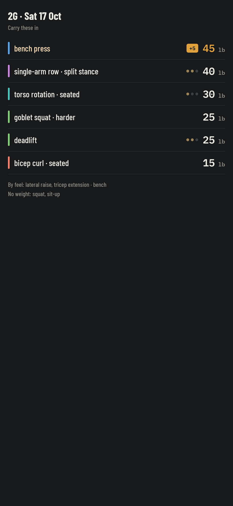
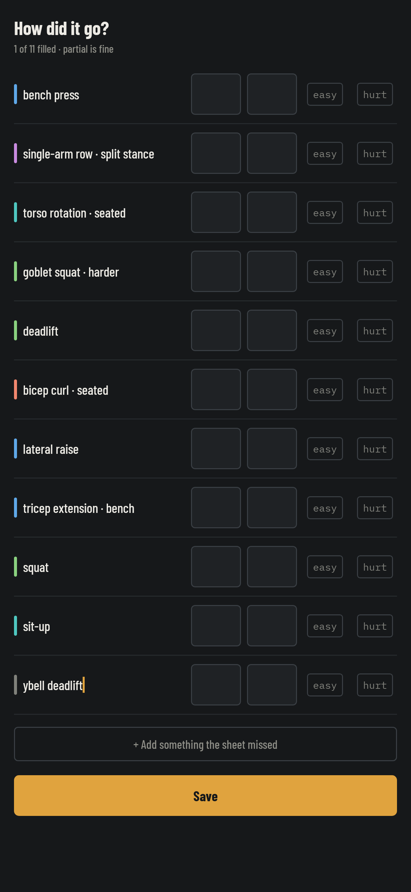
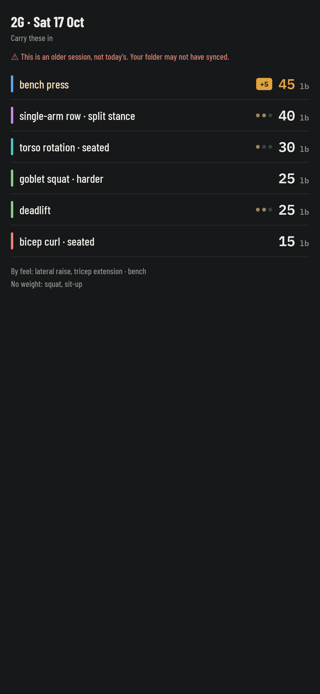

# Carry

The weights you carry into the room, and the numbers you bring back out.

Phones aren't allowed in the Orange Theory studio, so a workout app you use
*during* a session is useless. Carry is built for the two moments that are
left: a glance in the lobby at the few weights worth remembering, and a form
in the car afterwards.

It holds no account and talks to no server. A companion script writes the
day's session into a folder as JSON; Carry renders it, you fill it in, and it
saves the file back. Syncthing (or anything else that moves files) does the
rest.

  
  
  

*Invented exercises and weights — nobody's real training is in this repository.*

## How it works

1. **Pick a folder, once.** Whatever your file sync watches.
2. **Before class.** Open it in the lobby. The weights that *changed* lead;
   everything with nothing new to say is one line at the bottom.
3. **After class.** Fill in what you lifted. Anything the sheet didn't list
   gets added by hand — on a day with no intel for your class, that's most of
   the session.
4. **Save.** One JSON back into the folder.

## Status

Early. See [docs/BACKLOG.md](docs/BACKLOG.md) for what's next and
[docs/DESIGN.md](docs/DESIGN.md) for the decisions behind it.
